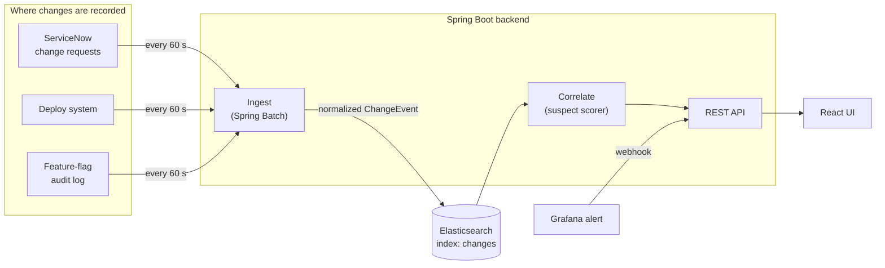

# Change Radar documentation

Change Radar answers the first question asked in almost every incident: **what changed right before this broke?**
It pulls change records from three kinds of systems into one Elasticsearch index, then ranks the changes most likely
to be behind an alert and explains why each one ranks where it does.

These pages explain the whole system, from the concepts to the code. Start with the overview if you're new, or jump
to the page you need.

| Page | What it covers |
|---|---|
| [Overview and concepts](overview.md) | The problem, how Change Radar solves it, and a glossary of every term used in the app and the code |
| [Using the app](user-guide.md) | Every page in the UI: Dashboard, Core Metrics, Changes, Investigate and Change Guidelines, with what each control does |
| [Architecture](architecture.md) | Components, backend packages, frontend structure, the data model and the Elasticsearch index, and the three ways to run it |
| [Process flows](process-flows.md) | Step-by-step sequence diagrams: ingestion, correlation, the Grafana webhook, an on-call investigation, the static demo and CI/CD |
| [Suspect scoring](scoring.md) | The correlation algorithm in full, with worked examples from the demo incidents |
| [Change sources and normalization](data-sources.md) | The three upstream sources, their raw formats, how each field is mapped, and the change guidelines check |
| [API reference](api.md) | Every HTTP endpoint (REST API, webhook, ingestion, mock sources, actuator) with parameters and responses |
| [Demo data and synthetic metrics](demo-data.md) | The planted incidents, the background change generator, the metric and region model behind the charts and map, and the static demo |
| [Tech stack](tech-stack.md) | Every language, framework and library, with versions and why it's there |
| [Development and operations](development.md) | Running locally, configuration, environment variables, tests, CI, deployment and troubleshooting |

## The 30-second version

1. **Ingest.** Every 60 seconds, one Spring Batch job per source pages through that source, turns each record into a
   common `ChangeEvent`, checks it against the change guidelines and upserts it into Elasticsearch.
2. **Search.** The Changes page and the chart markers query that one index, so the deploy log, change tickets and
   flag flips show up side by side.
3. **Correlate.** Given an alerting service and a time, the scorer looks at every change in the preceding window and
   scores each 0–100 from four factors: how recent it is, how close it is in the dependency graph, what kind of change
   it is, and its declared risk. The top 10 come back with plain-English reasons.
4. **Watch.** The Dashboard and Core Metrics pages plot metrics with change markers on top, so a dip next to a deploy
   is obvious. The world map shows which regions a metric dropped or spiked in.
