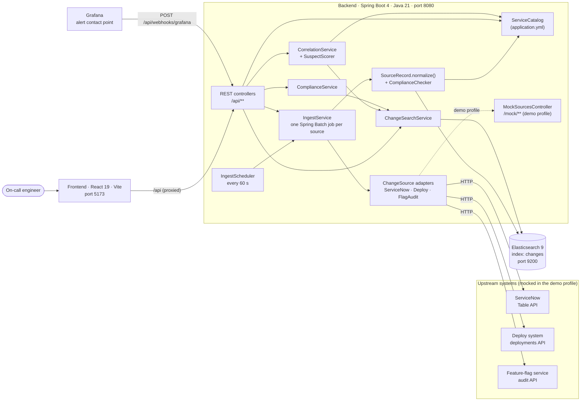

# Architecture

## System context

The backend is a single Spring Boot application. Elasticsearch is the only datastore. The frontend is a static
single-page app that talks to the backend over `/api`, except in the static demo, where it talks to an in-browser
implementation of the same API instead.

## Ways to run it

The same code runs in three topologies.

| | Docker Compose | Local development | Static demo (GitHub Pages) |
|---|---|---|---|
| **Frontend** | nginx serving the Vite build on port 5173 (container port 80) | Vite dev server on 5173 with hot reload | Vite build with `VITE_DEMO=true`, served by Pages |
| **API calls go to** | nginx proxies `/api/` to `backend:8080` | Vite proxies `/api` to `localhost:$BACKEND_PORT` (default 8080) | `demoApi` in the browser, reading `snapshot.json` |
| **Backend** | container built from `backend/Dockerfile`, demo profile | `./mvnw spring-boot:run` | none |
| **Elasticsearch** | `elasticsearch:9.4.6` container, single node, security off | the same container via `docker compose up -d elasticsearch` | none |
| **Change sources** | the backend's own `/mock/**` endpoints | the backend's own `/mock/**` endpoints, or real URLs | data frozen in the snapshot |
| **Scoring runs in** | Java (`SuspectScorer`) | Java | TypeScript (`scoring.ts`), tested against the same vectors |

See [Development and operations](development.md) for commands.

## Backend

Base package `dev.clarkngo.changeradar`, in [`backend/src/main/java`](../backend/src/main/java/dev/clarkngo/changeradar).

| Package | Classes | Responsibility |
|---|---|---|
| *(root)* | `ChangeRadarApplication` | Entry point. Enables configuration-property scanning and `@Scheduled` tasks. |
| `change` | `ChangeEvent`, `ChangeEventRepository`, `ChangeQuery`, `ChangeSearchService`, `ChangeSourceType`, `ChangeType`, `Risk` | The normalized data model, the Elasticsearch repository, and search. `ChangeSearchService` turns a `ChangeQuery` into an Elasticsearch bool query, sorted newest first. |
| `catalog` | `ServiceCatalog` | Services, teams and dependencies, bound from `changeradar.catalog` in `application.yml`. `teamOf(service)` and `dependencyDistance(from, to)` (breadth-first search, shortest path, cycle-safe). |
| `ingest` | `ChangeSource`, `SourceRecord`, `PagedSourceReader`, `IngestService`, `IngestScheduler`, `ComplianceChecker`, `IngestProperties`, `SourcesProperties` | The ingestion pipeline. Each source is a `ChangeSource` that fetches pages of `SourceRecord`s; each record normalizes itself into a `ChangeEvent`. `IngestService` builds and runs one Spring Batch job per source. |
| `ingest.servicenow` | `ServiceNowSource`, `ServiceNowChange` | ServiceNow Table API adapter and record mapping. |
| `ingest.deploys` | `DeploySource`, `DeployEvent` | Deployments API adapter and record mapping. Skips non-production deploys. |
| `ingest.flags` | `FlagAuditSource`, `FlagAuditEntry` | Feature-flag audit API adapter and record mapping. |
| `correlate` | `CorrelationService`, `SuspectScorer`, `Suspect`, `CorrelationResult` | Fetches the changes in an alert's window and ranks them. See [Suspect scoring](scoring.md). |
| `compliance` | `ComplianceService` | Groups changes in a period by team and computes guideline compliance. |
| `web` | `ChangeController`, `CorrelationController`, `ComplianceController`, `CatalogController`, `IngestController`, `GrafanaWebhookController` | The REST API. See [API reference](api.md). |
| `demo` | `DemoData`, `MockSourcesController`, `DemoController` | Only active in the `demo` profile. Generates 72 hours of raw source records with three planted incidents, serves them as mock upstream APIs, and exposes the incidents. See [Demo data](demo-data.md). |

### Design choices worth knowing

- **One Spring Batch job per source, not one job with three steps.** A failing ServiceNow API shouldn't stop deploys
  from being indexed. Each source reports its own status.
- **Records normalize themselves.** Each raw record type implements `SourceRecord.normalize(catalog)`, so all the
  quirks of a source live in one class next to its JSON shape. Returning `null` skips a record.
- **Idempotent writes.** A change's id is `source:externalId` (for example `deploys:1042`), so re-ingesting overwrites
  instead of duplicating, and every run can safely re-read the whole source.
- **Spring Batch without a database.** There's no JDBC dependency, so Spring Batch 6 uses its in-memory job
  repository. Job history isn't kept across restarts; the latest run per source is held in memory for
  `/api/ingest/status`.
- **The scorer is a pure function.** `SuspectScorer.score(change, alertService, alertTime, catalog)` has no I/O, which
  is what makes it easy to port to TypeScript and test against shared vectors.

## Data model

### `ChangeEvent`

One document per change in the Elasticsearch index. The mapping comes from the annotations on
[`ChangeEvent.java`](../backend/src/main/java/dev/clarkngo/changeradar/change/ChangeEvent.java); Spring Data
Elasticsearch creates the index from them if it doesn't exist.

| Field | Elasticsearch type | Example | Notes |
|---|---|---|---|
| `id` | document `_id` | `feature_flags:fa_1000` | `source` in lower case, a colon, then `externalId` |
| `source` | keyword | `FEATURE_FLAGS` | `SERVICENOW`, `DEPLOYS` or `FEATURE_FLAGS` |
| `externalId` | keyword | `fa_1000` | The record's id in its own system: ServiceNow `sys_id`, deployment id, or audit entry id |
| `type` | keyword | `FEATURE_FLAG` | `DEPLOY`, `CONFIG`, `INFRA` or `FEATURE_FLAG` |
| `service` | keyword | `ads-bidder` | |
| `team` | keyword | `ads` | Looked up from the catalog at ingestion time; `unknown` if the service isn't listed |
| `summary` | text (full-text searchable) | `Flag bidder.pacing-v2 rollout changed (10% → 100%)` | Built per source; see [normalization](data-sources.md) |
| `author` | keyword | `j.patel` | The owner. ServiceNow `assigned_to`, deploy `creator`, flag `actor` |
| `ticket` | keyword | `ADS-2291`, `CHG0032003` | Nullable. ServiceNow changes use their own change number |
| `risk` | keyword | `HIGH` | `LOW`, `MEDIUM` or `HIGH` |
| `hasRollbackPlan` | boolean | `true` | |
| `startedAt` | date | `2026-10-05T21:54:00Z` | Always stored as a UTC instant |
| `missingMetadata` | keyword (array) | `["ticket"]` | Any of `ticket`, `rollbackPlan`, `owner`. Empty means the change follows the guidelines |

### The index

- **Name:** `changes`, configurable with `changeradar.index-name`.
- **Queries:** text search uses `simple_query_string` over `summary`, `service`, `author`, `ticket` and `team` with
  AND between words. Service, team and type filters are `terms` filters; time is a `range` filter on `startedAt`;
  the compliance filter checks whether `missingMetadata` exists. Results are sorted by `startedAt` descending, and
  the total hit count is always tracked.
- **Unpaged reads** (correlation windows and compliance reports) are capped at 5,000 changes.
- **No deletes.** A change removed upstream stays in the index. Nothing expires old changes.

### Other response shapes

`Suspect`, `CorrelationResult`, `ComplianceService.Report`, `TeamCompliance`, `SourceRunResult` and `Scenario` are
described with examples in the [API reference](api.md). The frontend mirrors all of them in
[`frontend/src/api/types.ts`](../frontend/src/api/types.ts).

## Frontend

A single-page React app in [`frontend/src`](../frontend/src), built by Vite, with Ant Design components and custom
SVG charts.

| Path | Contents |
|---|---|
| `main.tsx`, `App.tsx` | Bootstraps React, applies the Ant Design theme (light or dark from the OS), loads the service catalog once, and renders the header, sidebar and current page. |
| `route.ts` | Hash routing (`#/page?params`). `useRoute()` re-renders on `hashchange`; `navigate(page, params)` changes the hash. Pages that take URL parameters are remounted when the parameters change. |
| `api/index.ts` | Picks the API client at build time: `demoApi` if `VITE_DEMO=true`, otherwise `httpApi`. |
| `api/types.ts` | TypeScript mirrors of the backend's JSON, and the `ChangeRadarApi` interface both clients implement. |
| `api/http.ts` | `httpApi`: thin `fetch` wrappers over `/api/**`. Array parameters are sent as repeated query keys. |
| `api/demo.ts` | `demoApi`: loads `snapshot.json` once, shifts every timestamp so the newest data looks recent, and implements search, correlation and compliance in the browser. |
| `api/scoring.ts` | A line-for-line port of `SuspectScorer` and `ServiceCatalog.dependencyDistance`. |
| `metrics.ts` | The synthetic metric generator: metric definitions, regions, the incident model, series and week-over-week helpers. See [Demo data](demo-data.md#synthetic-metrics). |
| `charts/MetricChart.tsx` | The time-series chart with change markers, alerts, a crosshair tooltip and a change tooltip. Plain SVG, resized with a `ResizeObserver`. |
| `charts/RegionMap.tsx` | The world choropleth. Country shapes from `world-atlas` (Natural Earth, 1:110m), projected with `d3-geo`'s Natural Earth projection; countries are grouped into regions. |
| `views/*View.tsx` | One component per page: `DashboardView`, `MetricsView`, `ChangesView`, `InvestigateView`, `ComplianceView`. `RegionalImpact.tsx` is the Dashboard's map card. |
| `components.tsx`, `format.ts` | Shared tags (change type, guideline status), labels, colors and date formatting (Day.js). |

There's no global state library: each page fetches what it needs through `api`, and the catalog is passed down from
`App`. Derived values that feed effects are memoized so a render can't trigger a new fetch.

## Security and scale limits

- **No authentication or authorization** on any endpoint, including `POST /api/ingest` and the webhook.
- Elasticsearch runs with security disabled in Docker Compose.
- Correlation reads at most 5,000 changes per window, and compliance aggregates in the JVM. At real volume both
  should use Elasticsearch aggregations and `search_after` paging.
- Ingestion re-reads every source in full on every run. Real sources would need an incremental cursor (for example
  "changed since the last run").
- Dependency hops are fixed weights over a static catalog. In production the graph would come from a service
  registry or tracing, and blast radius could be weighted by traffic.
