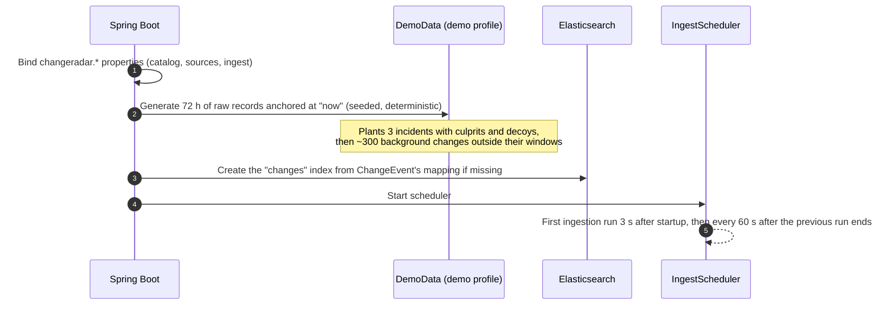
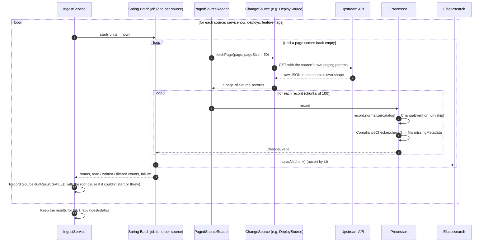
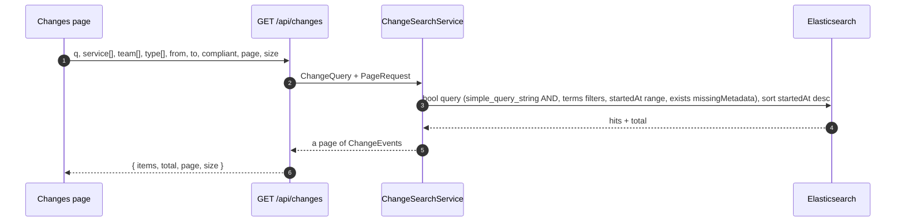
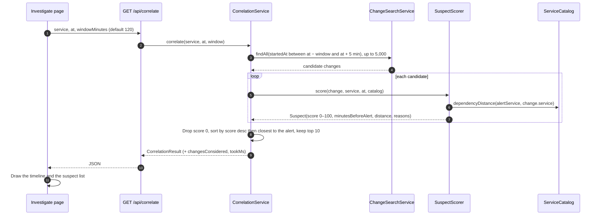
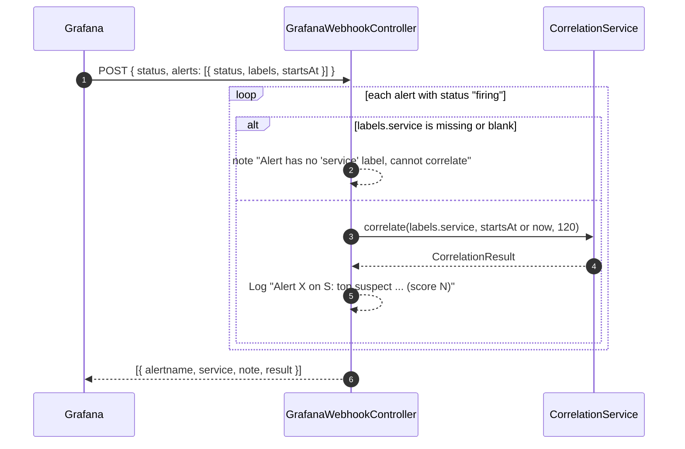
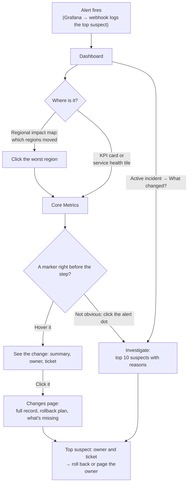
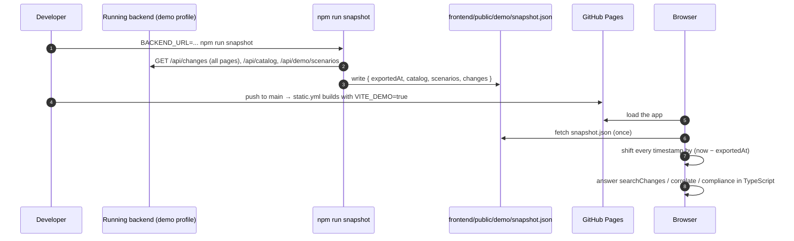
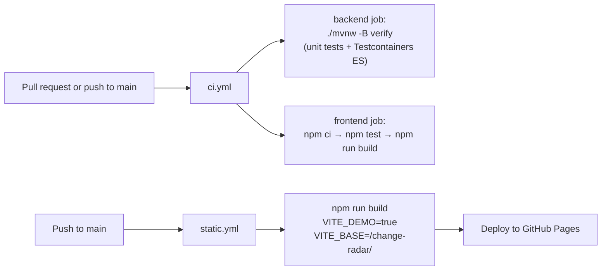

# Process flows

Step by step, what happens for each thing Change Radar does.

## 1. Backend startup

Without the demo profile, steps 2 and the `/mock/**` endpoints are skipped, and the source URLs must point at real
systems (`SERVICENOW_URL`, `DEPLOYS_URL`, `FLAGS_URL`).

## 2. Ingestion run

Triggered by the scheduler, or on demand with `POST /api/ingest`. Runs are serialized: a run started while another
is in progress waits for it.

Key behaviors:

- **Each source is isolated.** If one source's API is down, its job fails and the others still run.
- **Paging is hidden behind `fetchPage(page, size)`** with a 0-based page. Each adapter translates: ServiceNow uses
  `sysparm_offset = page × size`, deploys use a 1-based `page`, flags use a 0-based `page`.
- **Skipped records** (non-production deploys) are counted as `skipped`.
- **Upserts make it idempotent.** Re-reading the same records overwrites the same documents.

## 3. Searching changes

The Changes page, the chart markers and the dashboard's recent changes all use this path.

## 4. Correlating an alert

From the Investigate page, a chart alert click, an incident card, or the webhook.

The scoring formula is explained in [Suspect scoring](scoring.md).

## 5. Grafana webhook

Point a Grafana alerting contact point (type: webhook) at `/api/webhooks/grafana`.

Resolved alerts are ignored. The result is returned in the response and logged; nothing is stored, and nothing is
posted back to a chat tool. Wiring the response into Slack or an incident tool would be the next step.

## 6. An on-call investigation, end to end

How the pieces fit together when someone is actually paged.

## 7. The static demo

How the GitHub Pages build gets realistic data without a backend.

The timestamp shift keeps "26 minutes ago" true no matter when you open the demo.

## 8. CI and deployment

There's no deployment for the backend; it runs locally or in Docker Compose.
