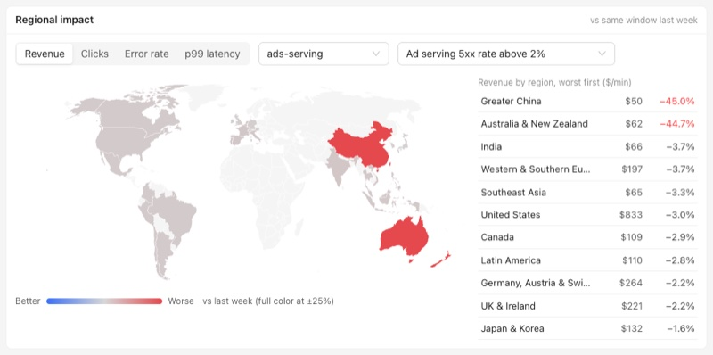
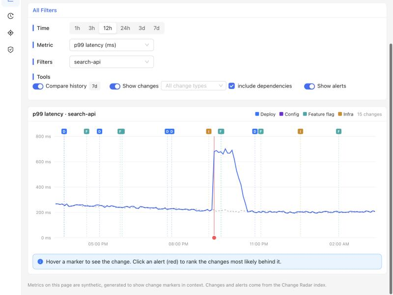
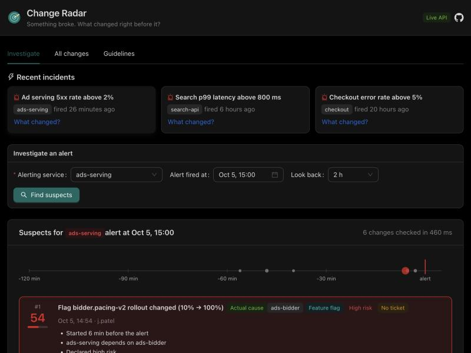

# Using the app

The UI has five pages, listed in the left sidebar. The sidebar collapses to icons on screens narrower than 1200 px.
The header shows your browser's time zone (every time in the app is shown in it) and a tag for the data mode:
**Live API** when talking to the backend, or **Static demo** on GitHub Pages, where everything runs in the browser.
Light and dark themes follow your operating system setting.

Every page has its own URL (hash routing, so links work on GitHub Pages), which means any view can be bookmarked or
pasted into an incident channel:

| Page | URL | Parameters |
|---|---|---|
| Dashboard | `#/dashboard` (also the default) | none |
| Core Metrics | `#/metrics` | `service`, `metric` (`revenue`, `clicks`, `errorRate`, `latencyP99`), `range` (`1h`, `3h`, `12h`, `24h`, `3d`, `7d`), `region` (a region id such as `us` or `gc`) |
| Changes | `#/changes` | `q` (search text), `service` |
| Investigate | `#/investigate` | `service`, `at` (ISO-8601 alert time). With both set, the investigation runs immediately. |
| Change Guidelines | `#/guidelines` | none |

Example: `#/investigate?service=checkout&at=2026-10-05T02:25:00Z` opens Investigate and ranks the suspects for a
checkout alert at that time.

## Dashboard

The landing page: the state of things in the last 24 hours at a glance.

### KPI cards

Four cards, each comparing the last 24 hours with the same 24 hours a week earlier:

| Card | Service | Metric | How the value is computed |
|---|---|---|---|
| Ads revenue | `ads-serving` | revenue | Sum of the 5-minute samples over 24 h |
| Checkout revenue | `checkout` | revenue | Sum of the 5-minute samples over 24 h |
| Search p99 latency | `search-api` | p99 latency | Average of the samples |
| Checkout error rate | `checkout` | error rate | Average of the samples |

The percentage underneath is red when the metric moved the bad way (revenue down, latency or errors up) and green
otherwise. Click a card to open that metric in Core Metrics over 24 hours.

### Regional impact

A world map showing **where** a metric moved, so a global drop can be traced to the markets behind it.

- **Metric:** Revenue, Clicks, Error rate or p99 latency.
- **Service:** one service, or *All services* (revenue and clicks are summed; error rate and latency are averaged).
- **Window:** either *Around an incident* (from 10 minutes before a recent alert to 40 minutes after, or now if
  that's sooner) or a rolling window (*Last 1h*, *6h* or *24h*). Picking an incident also switches the service to the
  one that alerted. The card opens on the newest incident from the last 24 hours, or *Last 1h* if there is none.

Each region is compared with the same window a week earlier and colored on a diverging scale: **red** where the
metric moved the bad way, **blue** where it improved, **gray** when roughly flat. Color saturates at a 25% change.
Countries outside the 11 tracked regions are drawn blank.

The list beside the map ranks regions worst first, with the current value (per minute for revenue and clicks) and
the week-over-week change. Changes worse than 5% are red; improvements better than 5% are green.

Hover a country for its region's value and change. **Click a region**, on the map or in the list, to open Core
Metrics for that service, metric and region. The time range carries over: an incident window or *Last 1h* opens 3
hours, *Last 6h* opens 12 hours, and *Last 24h* opens 24 hours.

### Service health

One tile per service in the catalog, with its owning team, colored by its alerts:

| Status | Color | Rule |
|---|---|---|
| Critical | red | An alert on this service in the last hour |
| Warning | amber | An alert on this service in the last 24 hours |
| Healthy | teal | Neither |

Health only reflects alerts on the service itself, not on services that depend on it. Click a tile to open that
service in Core Metrics.

### Active incidents

Alerts from the last 24 hours, newest first. An alert younger than an hour is tagged **P1**, older ones **P2**.
**What changed?** opens Investigate for that service and alert time.

### Recent changes

The six newest changes from every source, with time, type, service and summary. **All changes** opens the Changes
page.

## Core Metrics

One metric for one service over time, with every relevant change drawn on top. This is the core "what changed?"
view: if a line steps up or down, the marker just before the step is usually the answer.

### Filters

| Control | Options | Default |
|---|---|---|
| **Time** | 1h, 3h, 12h, 24h, 3d, 7d, ending now | 3h |
| **Metric** | Revenue ($/min), Clicks (clicks/min), Error rate (%), p99 latency (ms) | Revenue |
| **Filters** | Service, and Region (*All regions* or one of the 11) | `ads-serving`, All regions |
| **Compare history** | Adds a dashed line for the same window 7 days earlier | On |
| **Show changes** | Draws change markers. The type selector limits which change types appear. | On, all types |
| **include dependencies** | Also shows changes to every service upstream of the selected one, not just the service itself | On |
| **Show alerts** | Draws alerts on the selected service as a red line with a dot on the time axis | On |

The window is fixed when the page loads, so it doesn't drift while you hover. Reload or change the URL to move it
forward. Chart resolution adapts to the range: one point per minute up to 6 hours, every 5 minutes up to 2 days,
hourly beyond that.

### Reading the chart

- **Change markers** sit along the top edge, each with a dashed line down through the plot. The letter and color give
  the type: **D** deploy (blue), **C** config (purple), **F** feature flag (cyan), **I** infra (gold). The legend
  above the chart shows how many changes are visible.
- **Hover the plot** for a crosshair and the value of each line at that time.
- **Hover a marker** for the change: type, summary, service, start time, author and ticket.
- **Click a marker** to open the Changes page searching for that change's ticket (or the start of its summary).
- **Click an alert dot** (red, on the time axis) to open Investigate for that alert.

## Changes

Every change from every source in one table, newest first, 20 per page.

| Control | What it does |
|---|---|
| **Search** | Free text over summary, service, author, ticket and team. Every word must match. |
| **Services** | One or more services |
| **Change types** | Deploy, Config, Feature flag, Infra |
| **Guidelines** | All changes, only those that follow the guidelines, or only those missing metadata |
| **Time range** | A start and end date and time |

Columns: ticket (or *None*), type, service, start time (hover for "x minutes ago"), owner, summary, and guideline
status. Narrow screens hide the owner and guidelines columns.

**Expand a row** for every field: full summary, source (*Change request*, *Deploy system* or *Flag audit log*), the
id in that source, team, risk, whether there's a rollback plan, and what's missing. Two shortcuts:

- **View *service* metrics** opens Core Metrics for that service over 24 hours.
- **Investigate an alert 10 min later** ranks suspects as if that service had alerted 10 minutes after this change
  started. Useful for asking "if this goes wrong, what else would be a suspect?"

## Investigate

Ranks the changes most likely to be behind an alert.

### Recent incidents

Cards for the demo incidents. Clicking one fills in the form and runs the investigation.

### The form

| Field | Meaning | Default |
|---|---|---|
| **Alerting service** | The service whose alert you're investigating | from the URL, or empty |
| **Alert fired at** | When the alert fired | from the URL, or now |
| **Look back** | How far before the alert to search: 30 min, 1 h, 2 h or 4 h | 2 h |

**Find suspects** runs the correlation. See [Suspect scoring](scoring.md) for exactly how scores are computed.

### Results

- **Header:** the alert, and how many changes were checked and how long it took.
- **Timeline:** every suspect on a time axis that ends just after the alert. Bigger, redder dots score higher.
  Hover a dot for its score and summary.
- **Suspect list:** the top 10, best first. Each row shows its rank and score (red at 50 or more, orange at 20 or
  more, gray below), the summary, service, type, high-risk and guideline tags, start time, author, ticket, and the
  reasons behind the score. The top suspect is highlighted. In the demo, the real culprit is tagged
  **Actual cause**, and a note explains the incident and its decoys.

If nothing changed in the window, the page suggests a longer look-back.

## Change Guidelines

How well each team documents its changes. Every site-impacting change should have a **ticket**, an **owner** and a
**rollback plan**; see [data sources](data-sources.md#change-guidelines) for how each is determined.

- **Period:** 24 hours, 3 days or 7 days, ending now.
- **Summary:** the share of all changes that follow the guidelines, how many changes there were, and the team that
  needs the most help.
- **Team table:** sorted worst first. Each row has a progress bar (green at 90% or more, amber at 75% or more, red
  below), compliant / total, the most often missing items with counts, and the team's services.

Teams see their own numbers, which is what tends to change habits.
